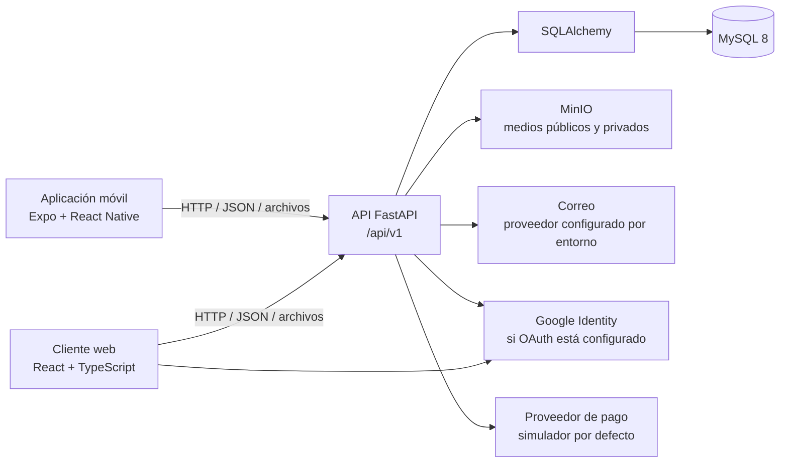
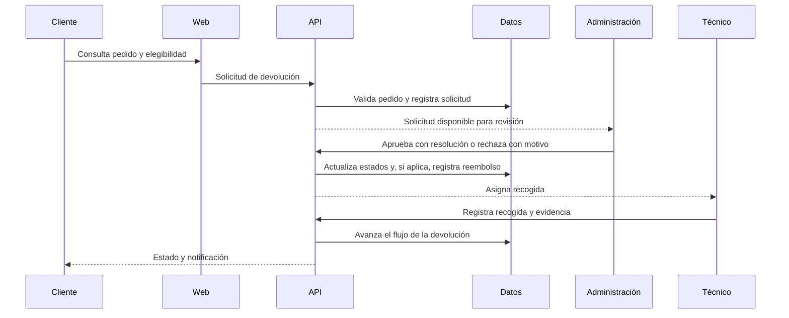

# Manual técnico de NeoDomus

**Sistema:** NeoDomus — gestión y automatización del hogar inteligente
**Versión documental:** 2.1
**Revisión:** 18 de noviembre de 2026
**Público:** soporte técnico, administración y mantenimiento

## Propósito y alcance

Este manual reúne la arquitectura, los procesos técnicos, la estructura del código y las pautas de operación que se pueden comprobar en el checkout revisado. Sirve para orientar soporte y mantenimiento; no certifica una instalación productiva ni sustituye la documentación de una infraestructura desplegada.

La descripción de una ruta, pantalla o módulo confirma que existe en el código, pero no que esté habilitado en cada entorno. Los valores de `.env`, las credenciales, la URL pública, los contactos de soporte y los acuerdos operativos se deben confirmar con quien administra la instalación. No se incluyen secretos.

**Fuentes de referencia:** código y configuración actuales del repositorio; los manuales de referencia enviados por el equipo se usaron para organizar los temas y ampliar la cobertura. Si una descripción difiere del comportamiento vigente, se debe contrastar con la implementación actual y el entorno donde se opera.

## Contenido

1. [Arquitectura](#arquitectura)
2. [Procesos principales](#procesos-principales)
3. [Diagramas](#diagramas)
4. [Usuarios, roles y acceso](#usuarios-roles-y-acceso)
5. [Datos y archivos](#datos-y-archivos)
6. [Plataforma y versiones](#plataforma-y-versiones)
7. [Estructura del código](#estructura-del-código)
8. [Instalación y puesta en marcha](#instalación-y-puesta-en-marcha)
9. [Operación y mantenimiento](#operación-y-mantenimiento)
10. [Diagnóstico técnico](#diagnóstico-técnico)
11. [Soporte y acuerdos de servicio](#soporte-y-acuerdos-de-servicio)
12. [Glosario](#glosario)
13. [Referencias y control del documento](#referencias-y-control-del-documento)

## Arquitectura

NeoDomus se mantiene en un repositorio con backend, cliente web y aplicación móvil. El backend FastAPI expone la API REST bajo `/api/v1`; los clientes web y móvil consumen esa API. SQLAlchemy conecta la lógica con MySQL y Alembic mantiene las migraciones. MinIO guarda objetos e imágenes.

El Compose local declara los servicios `db`, `api`, `minio`, `frontend` y `caddy`. Caddy es un proxy incluido en Compose para el entorno local; su presencia no confirma la configuración de un despliegue productivo. La API ofrece `/docs`, `/redoc` y `/openapi.json` cuando está ejecutándose.

## Procesos principales

### Autenticación y sesiones

El backend agrupa registro de cliente, verificación de correo, inicio y cierre de sesión, renovación de sesión, recuperación y cambio de contraseña en `be/app/routers/auth.py` y `be/app/services/auth_service.py`. Las rutas de autenticación se publican bajo `/api/v1/auth`.

En el acceso local, el servicio valida la identidad y el estado de la cuenta y devuelve tokens JWT. La web guarda tokens por pestaña y envía el token de acceso en `Authorization: Bearer`; la aplicación móvil también usa ese encabezado y conserva la sesión en el almacenamiento de la app. El backend además establece cookies `HttpOnly` y puede aceptarlas como alternativa de compatibilidad. La duración de los tokens y las banderas efectivas de las cookies dependen de la configuración.

### Acceso con Google

El backend recibe una credencial de Google en `/api/v1/auth/google` y valida el ID token con la biblioteca oficial de Google, comprobando su audiencia contra `GOOGLE_SIGNIN_CLIENT_ID` y el correo verificado. La interfaz web utiliza la configuración de cliente de `fe/src/utils/google.ts`; la aplicación presenta el acceso de Google cuando su configuración de cliente lo permite.

Para habilitar este flujo en un entorno, el equipo que administra Google Identity debe registrar los orígenes y credenciales de ese entorno y coordinar el identificador de cliente del frontend con el esperado por el backend. En Compose se declaran `VITE_GOOGLE_CLIENT_ID` para el frontend y `GOOGLE_SIGNIN_CLIENT_ID` para validar la credencial; hay otras variables `GOOGLE_*` para flujos de correo y empleados. Los valores reales se mantienen fuera de la documentación. La configuración de Google debe verificarse en cada entorno antes de comunicar que el acceso está habilitado.

### Pedidos y pagos

El checkout web protegido para clientes envía la compra al módulo de pedidos. El backend valida los datos, aplica sus reglas de stock y registra pedido, pago y factura conforme a la implementación de `be/app/services/`. La configuración de Compose usa `PAYMENT_PROVIDER=simulator` por defecto: ese modo no procesa un cargo bancario real. Que una interfaz muestre medios de pago no demuestra que exista una pasarela real conectada.

### Citas y trabajo técnico

El módulo de citas gestiona solicitudes, disponibilidad, asignaciones, estados y evidencias. El administrador dispone de funciones de reasignación; los técnicos consultan su trabajo y registran acciones permitidas por su rol. Las reglas actuales están en `be/app/routers/citas.py`, `be/app/routers/tecnicos.py` y sus servicios. Para el contrato detallado de rutas, usa la especificación OpenAPI del entorno en ejecución.

### Devoluciones y reembolsos

El flujo actual contempla solicitudes de devolución ligadas a pedidos, su revisión administrativa y la recogida de productos por un técnico asignado. El cliente consulta el pedido y sus devoluciones desde el perfil; el backend publica la elegibilidad, creación y consulta de solicitudes bajo `/api/v1/devoluciones`. El administrador revisa solicitudes y registra aprobación con resolución de reembolso o cambio, o rechazo con motivo. Las transiciones incluyen los estados de revisión, aprobación o rechazo, producto en devolución, recibido y reembolso procesado.

La recogida se registra por línea y tiene su propio estado (`Asignada` o `Recogida`). El técnico adjunta evidencia de la recogida y, cuando corresponde, de la entrega del producto de cambio. La solicitud avanza según el resultado de las líneas. Las evidencias se sirven mediante rutas protegidas, con validación del rol y la asignación. El módulo de devoluciones también conserva operaciones de compatibilidad para registros anteriores; para integraciones nuevas debe consultarse OpenAPI y el flujo de solicitudes vigente.

El reembolso se registra en el sistema. Con el proveedor de pago predeterminado en modo simulador, ese registro no equivale a una devolución efectiva de dinero por una entidad financiera.

### Correo y archivos

El correo puede usar los proveedores declarados en `be/app/utils/email.py` (SMTP, Resend o Gmail API) según `EMAIL_PROVIDER` y las variables disponibles. Verificación, recuperación y notificaciones dependen de la configuración del entorno.

MinIO separa el bucket público de recursos que se sirven directamente y el bucket privado destinado a evidencias nuevas. Las evidencias privadas usan referencias marcadas y se leen a través del backend después de verificar autorización. Pueden existir referencias heredadas en almacenamiento público; antes de tratar archivos históricos como privados, confirma su origen y permisos. Los nombres de buckets y endpoints públicos se configuran mediante `MINIO_*`.

## Diagramas

El diagrama de arquitectura anterior resume los componentes y sus conexiones. El flujo simplificado de solicitud y recogida de una devolución es:

Para el modelo relacional vigente, consulta [esquema de base de datos](../../referencia-tecnica/database-schema.md) y [diccionario de datos](../../referencia-tecnica/diccionario-de-datos.md). El repositorio es la fuente de los diagramas vigentes; no se debe asumir que un diagrama antiguo representa todas las migraciones.

## Usuarios, roles y acceso

La web registra rutas públicas y áreas protegidas para `cliente`, `tecnico` y `administrador` en `fe/src/App.tsx`. El backend aplica dependencias de usuario y rol en sus routers; esconder una opción en una interfaz no sustituye la autorización del servidor.

| Perfil | Áreas identificadas | Acceso principal |
|---|---|---|
| Visitante | Inicio, catálogo, detalle, carrito, información, contacto y páginas legales | Web; el checkout requiere una sesión de cliente. |
| Cliente | Perfil, pedidos, citas, técnicos, novedades, ayuda y notificaciones | Web y secciones de cliente en móvil. |
| Técnico | Citas, entregas, recogidas, devoluciones, historial, clientes, mensajes y calificaciones | Web y secciones de técnico en móvil. |
| Administrador | Productos, catálogo, técnicos, instalaciones, pedidos, facturas, consultas, devoluciones, novedades, clientes, proveedores, reportes y notificaciones | Panel web de administración. |

La cuenta, el rol y el estado de habilitación determinan el acceso. La gestión de empleados y las solicitudes de cuenta se describe en los routers de usuarios, técnicos, solicitudes y autenticación; los permisos concretos deben confirmarse en la versión desplegada.

## Datos y archivos

- Los modelos ORM están en `be/app/models/`; los esquemas de entrada y salida, en `be/app/schemas/`; la lógica de negocio, en `be/app/services/`.
- Alembic aplica las migraciones de `be/alembic/versions/`. El último archivo presente en el checkout revisado es `0066_reparar_refresh_tokens.py`; verifica la secuencia y la revisión destino antes de cualquier despliegue.
- Compose declara MySQL 8.0 y el esquema `neodomus`. La conexión se configura mediante variables de entorno.
- MinIO usa configuración pública y privada independiente. Las evidencias privadas se recuperan mediante rutas autorizadas del backend; las imágenes de catálogo pueden ser públicas.
- Las facturas y reportes PDF se generan desde servicios de backend. Consulta sus routers y servicios actuales para confirmar el formato y la disponibilidad del envío o descarga en un entorno concreto.

El [esquema](../../referencia-tecnica/database-schema.md) y el [diccionario](../../referencia-tecnica/diccionario-de-datos.md) son referencias mantenidas dentro de `docs/`; para confirmar el estado físico de una base concreta, hay que comparar modelos y migraciones con esa base.

## Plataforma y versiones

Las versiones de esta tabla provienen de los manifiestos presentes en el checkout consultado. No son una matriz de compatibilidad para equipos de usuario final.

| Componente | Declaración revisada | Fuente |
|---|---|---|
| Backend | Python `>=3.11`; FastAPI `0.163.1`; SQLAlchemy `2.0.30`; Alembic `1.13.2` | `be/pyproject.toml` |
| Web | React `18.3.1`; React Router DOM `^7.18.0`; Vite `5.4.21`; TypeScript `5.9.3` | `fe/package.json` |
| Móvil | Expo `58.0.23`; Expo Router `58.0.30`; React Native `0.88.1`; React `19.3.0` | `movil/package.json` |
| Datos | MySQL `8.0` | `docker-compose.yml` |
| Archivos | MinIO; la imagen Compose usa la etiqueta `latest` | `docker-compose.yml`, `be/app/services/minio_service.py` |
| Proxy local | Caddy `2-alpine` | `docker-compose.yml` |

Las lockfiles fijan el conjunto instalado en un build concreto. Las imágenes con etiqueta móvil como `latest` pueden cambiar y no representan una versión reproducible.

## Estructura del código

| Ruta | Contenido |
|---|---|
| `be/app/main.py` | Construcción de FastAPI, middlewares, routers, endpoints de salud y ciclo de vida del scheduler. |
| `be/app/routers/` | Endpoints agrupados por identidad, clientes, técnicos, productos, citas, pedidos, devoluciones, reembolsos y otros módulos. |
| `be/app/services/` | Procesos de negocio e integraciones de base de datos, correo, MinIO y generación de documentos. |
| `be/app/models/`, `be/app/schemas/` | Modelos de persistencia y contratos de datos. |
| `be/alembic/versions/` | Historial de cambios del esquema. |
| `fe/src/App.tsx` | Rutas de la aplicación web y controles de rol a nivel de navegación. |
| `fe/src/services/`, `fe/src/contexts/` | Cliente API y estado compartido de la interfaz, incluida la sesión. |
| `movil/app/`, `movil/services/` | Navegación Expo Router y servicios del cliente móvil. |
| `shared/` | Recursos compartidos entre paquetes. |
| `docs/` | Manuales, requisitos, guías y referencias del proyecto. |

## Instalación y puesta en marcha

Para instrucciones completas, sigue [instalación con Docker](../../setup/con-docker.md) o [instalación sin Docker](../../setup/sin-docker.md). No dupliques secretos en este manual; crea `.env` a partir de `.env.example` y completa sus valores de forma local.

El Compose actual publica web en `5173`, API en `8000`, MySQL en `3307`, MinIO en `9000` y la consola MinIO en `9001`. La API aplica las migraciones antes de iniciar Uvicorn. Confirma los puertos, las variables obligatorias y los servicios que correspondan antes de arrancar.

En móvil, `EXPO_PUBLIC_API_URL` debe apuntar a una dirección de API alcanzable desde el teléfono o emulador. `localhost` dentro de un dispositivo se refiere al propio dispositivo. Consulta el ejemplo de configuración móvil y adapta solo el valor local del entorno.

## Operación y mantenimiento

- Comprueba el estado de los contenedores y consulta sus registros con las instrucciones de [Docker](../../setup/con-docker.md).
- La API incluye `/health` y `/health/readiness`. El segundo comprueba la conexión a la base de datos y la disponibilidad del almacenamiento configurado.
- Antes de actualizar, revisa el historial Alembic y prepara el procedimiento de respaldo y recuperación que use el entorno. No se documenta aquí una política de respaldo productiva confirmada.
- Revisa el estado de MySQL y MinIO antes de investigar fallos de lectura o escritura de datos y archivos.
- Mantén las credenciales fuera de Git y los documentos. Los valores de desarrollo y el sembrado local no deben asumirse apropiados para producción.
- Consulta los [runbooks](../../runbooks/) y [guías de instalación](../../setup/) para procedimientos operativos documentados.

## Diagnóstico técnico

| Síntoma | Comprobaciones de soporte |
|---|---|
| La web no obtiene datos | Comprueba que frontend y API estén disponibles, la URL `VITE_API_URL`, los registros de API y la configuración CORS del entorno. |
| La API no inicia | Revisa los registros de `api`, la conexión MySQL, las variables requeridas y el resultado de las migraciones. |
| El servicio no está listo | Consulta `/health/readiness`; distingue el estado de base de datos y almacenamiento informado en la respuesta. |
| No se envían mensajes de correo | Confirma `EMAIL_PROVIDER`, credenciales y acceso al proveedor configurado; revisa los registros sin exponer secretos. |
| No funciona el acceso con Google | Comprueba que el origen web esté registrado en Google Identity y que los identificadores de cliente del frontend y backend sean compatibles con el mismo flujo. Revisa la respuesta de `/auth/google` y registros, sin almacenar ID tokens. |
| No cargan imágenes o evidencias | Comprueba MinIO, endpoints, buckets y referencias del objeto. Para evidencias, revisa autorización y asignación antes de diagnosticar permisos. |
| Una devolución no avanza | Revisa el estado de solicitud, su resolución, las líneas de devolución, la asignación y evidencia de recogida, y el registro del reembolso cuando aplique. No alteres datos manualmente para forzar la transición. |
| El pago aparece aprobado o rechazado | Comprueba `PAYMENT_PROVIDER`. Con `simulator`, el resultado es académico y no acredita movimiento de dinero. |

Registra fecha, hora, entorno, módulo, identificador de operación y respuesta técnica. Elimina de los reportes credenciales, cookies, tokens y datos personales que no sean necesarios.

## Soporte y acuerdos de servicio

En el repositorio consultado no se identifican un contacto oficial de soporte, un horario de atención ni tiempos de respuesta aprobados. El equipo responsable debe añadir esos datos antes de distribuir el manual como procedimiento operativo. Los ANS deben aprobarse con el responsable del servicio; este documento no fija compromisos de disponibilidad ni tiempos de solución.

## Glosario

- **API:** interfaz de servicios que comunica los clientes con el backend.
- **Alembic:** herramienta que registra y aplica migraciones de la base de datos.
- **ID token:** credencial emitida por Google Identity que el backend valida para el acceso OAuth.
- **MinIO:** almacenamiento compatible con S3 para objetos y evidencias.
- **OAuth:** mecanismo de autorización e identidad usado aquí para el acceso con Google.
- **OpenAPI:** contrato legible de las rutas y esquemas de la API.
- **ORM:** mapeo de modelos de código a tablas relacionales, realizado aquí por SQLAlchemy.
- **Proveedor de pago simulado:** modo de prueba que no procesa dinero real.
- **Revisión de migración:** identificador Alembic que representa un punto del historial de esquema.

## Referencias y control del documento

- [Manual de usuario](../usuario/MANUAL_DE_USUARIO.md)
- [Arquitectura de referencia](../../referencia-tecnica/architecture.md)
- [API y endpoints](../../referencia-tecnica/api-endpoints.md)
- [Esquema de base de datos](../../referencia-tecnica/database-schema.md)
- [Diccionario de datos](../../referencia-tecnica/diccionario-de-datos.md)
- [Instalación con Docker](../../setup/con-docker.md)
- [Instalación sin Docker](../../setup/sin-docker.md)
- [Runbooks](../../runbooks/)

| Versión | Fecha | Cambios |
|---|---|---|
| 1.0 | 2026-10-30 | Primera versión de trabajo. |
| 2.0 | 2026-10-30 | Reorganización del manual y referencias a documentación técnica. |
| 2.1 | 2026-11-18 | Actualización frente a los adjuntos y el código revisado; ampliación de arquitectura, OAuth, devoluciones, almacenamiento y operación; actualización de versiones y revisión de migraciones. |

**Aprobación institucional:** pendiente de confirmación por el equipo del proyecto.
